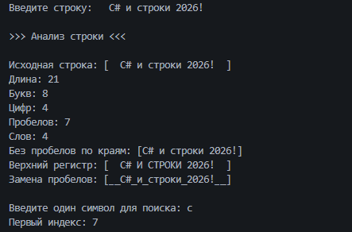

# Практическая работа №19

Автор: Михальчук Родион 
Группа: ИСП-254

## Тема

Строки в C#.

## Что реализовано

- определение длины строки;
- подсчёт букв, цифр, пробелов и слов;
- поиск первого индекса символа;
- удаление пробелов по краям;
- перевод в верхний регистр;
- замена пробелов на подчёркивания.

## Короткие ответы

1. Чем отличаются string и char?

Ответ: string это строка, char это один символ.

2. Почему вызов text.Trim() без сохранения результата не меняет text?

Ответ: Строки неизменяемы Trim() возвращает новую строку, а text остаётся прежним.

3. Зачем при разделении строки используется RemoveEmptyEntries?

Ответ: Убирает пустые части от лишних пробелов, чтобы они не считались словами.

## Результат

